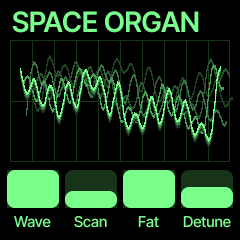
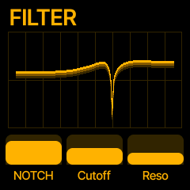
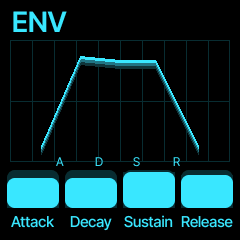
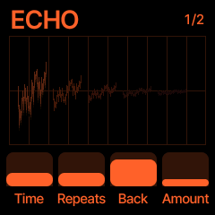
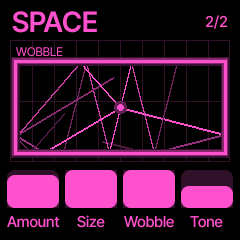
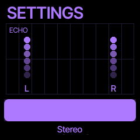
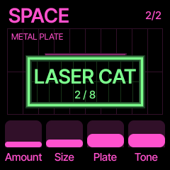

# Kosmo

[](LICENSE)

Kosmo is a kids-friendly wavetable synth firmware for the M-VAVE FM-1. It is a fork of
[Felucca](https://github.com/hugelton/Felucca) cut down to one engine and given a simple, colourful UI: big
pictures, few knobs, nothing hidden in menus.

## Sound

- **Wavetable oscillator.** WAVE picks one of 8 tables (ROBOT TALK, LASER, MONSTER, CHIPTUNE, ALIEN, CRYSTAL,
  GHOST, SPACE ORGAN). Each has 64 frames, a designed morph; SCAN moves through them and glides smoothly. High notes
  use band-limited copies of the tables, so they alias far less.
- **FAT and DETUNE.** FAT (0 to 4) adds extra voices per note, spread left and right; DETUNE spreads their pitch.
- **ADSR envelope** and 8 voices, with polyphonic and legato modes (set per preset).

## Filter designs

The FILTER page picks the type; CUT is the cutoff and RES the resonance. The page draws the filter's true response.

- **LP, BP, HP, NOTCH:** a Moog-style 4-pole ladder with saturating stages. The four types come from mixing the
  ladder's stage outputs (Oberheim-style pole mixing).
- **COMB:** a short feedback comb. CUT sets the delay (the pitch of the comb) and RES the feedback.

## FX designs

Signal chain: voices, ECHO, SPACE, limiter, out. The whole chain is stereo.

- **ECHO:** a vintage 12-bit stereo delay. The memory is packed 12-bit at a ~22 kHz clock, up to about 1.5 s, and
  every repeat gets darker and soft-clipped. TIME glides the pitch of the repeats like tape. Characters: CLEAN
  (with a little wow and flutter), CRUNCH, TOY, BACKWARDS, ROBOT. SETTINGS picks PING-PONG or STEREO.
- **SPACE:** an 80s-style digital reverb, an 8-line feedback delay network with its own tank rate per room. Rooms:
  BEDROOM, CASTLE, METAL PLATE, CLOUD, GATED, WOBBLE. AMOUNT is the send, SIZE the room size, TONE the damping.

## Pages and controls

One button per page; K1 to K4 turn the four bars at the bottom.

| Button | Page | K1 | K2 | K3 | K4 |
| --- | --- | --- | --- | --- | --- |
| HOME | WAVE | Wave | Scan | Fat | Detune |
| EDIT | FILTER | Type | Cutoff | Reso | |
| ENV | ENV | Attack | Decay | Sustain | Release |
| FX | ECHO | Time | Repeats | Character | Amount |
| FX again | SPACE | Amount | Size | Room | Tone |
| GLO | SETTINGS | Echo ping-pong / stereo | | | |

OCT- and OCT+ shift the 27 keys by an octave (both together: back to the middle). The PRESETS encoder steps
through the factory presets (SPACE WHALE, LASER CAT, ROBOT DOG, MAGIC BELLS, TOY ORGAN, BUZZY BEE, GLASS GHOST,
PIXEL PUP) and shows the name. USB-MIDI and TRS MIDI in play the voices; the MASTER knob sets the volume.

| WAVE | FILTER | ENV |
| --- | --- | --- |
|  |  |  |

| ECHO | SPACE | SETTINGS | PRESET |
| --- | --- | --- | --- |
|  |  |  |  |

## Build, test, install

Needs [mise](https://mise.jdx.dev) and, on macOS, Docker (the JieLi toolchain is Linux only). See
[BUILDING.md](BUILDING.md).

```
mise run build        # build/kosmo.bin, the update loader and the installable package
mise run build:docker # the same, forced into the linux/amd64 container
mise run test         # host tests (DSP, MIDI, storage, USB, the update path, the browser emulator)
mise run smoke        # boots build/kosmo.bin in fm1-emulator, plays a key, prints PASS
mise run emu-check    # visits every page, compares LCD snapshots with tests/emu_ref (mise run emu-check -- --update)
mise run emu-load     # guest audio-ISR load (chord at FAT 0 / 4) and WAVE redraw length, against limits
mise run usb-check    # CDC console answers in the emulator at -Os and -O2
mise run stress       # fm1-emulator tests/stress.py, seed 1
mise run web          # browser emulator in build/emu
```

Install the package on a connected FM-1 (needs `pip3 install mido python-rtmidi`; at your own risk):

```
python3 tools/fm1_install.py build/kosmo.fwsc
python3 tools/fm1_install.py --info    # identity of the connected FM-1
```

## Licence and credits

Kosmo is derived from [Felucca](https://github.com/hugelton/Felucca) by Leo Kuroshita (@kurogedelic), Hügelton
Instruments, and is free software under [GPL-3.0-only](LICENSE), as Felucca is. The bundled fonts keep their own
licences ([LICENSES/](LICENSES/)); details in [LICENSING.md](LICENSING.md). The browser emulator follows
[X0X](https://github.com/charlesvestal/fm1-x0x) by charlesvestal (GPL-3.0).

M-VAVE and FM-1 are trademarks of their respective owners. Kosmo is not affiliated with or endorsed by them.
